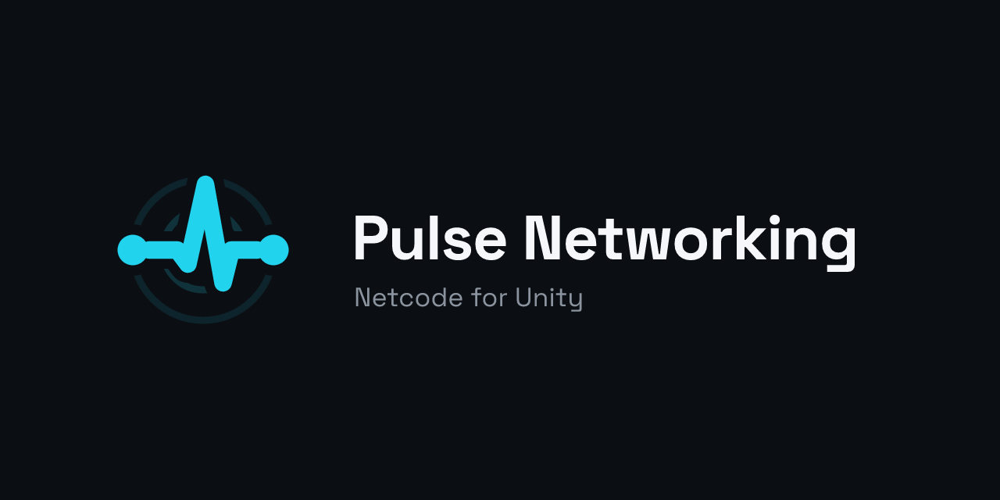

<p align="center">
  
</p>

**Pulse** is open source netcode for Unity 6, for hosted or dedicated server games, with the networking boilerplate already made for you.

## Packages
| Package | Adds |
|---|---|
| [`com.pulsenetworking.pulse`](https://github.com/nexusverypro/pulse/tree/master/Packages/com.pulsenetworking.pulse) | Transports, serialization, netcode |
| [`.relay`](https://github.com/nexusverypro/pulse/tree/master/Packages/com.pulsenetworking.pulse.relay) | Relay and TURN, for hosts behind NAT |
| [`.lagcompensation`](https://github.com/nexusverypro/pulse/tree/master/Packages/com.pulsenetworking.pulse.lagcompensation) | Hit checks against where targets were on the shooter's screen |
| [`.xr`](https://github.com/nexusverypro/pulse/tree/master/Packages/com.pulsenetworking.pulse.xr) | Networked XR rigs and grabbables |
| [`.diagnostics`](https://github.com/nexusverypro/pulse/tree/master/Packages/com.pulsenetworking.pulse.diagnostics) | An in-game overlay with traffic, ping and state sizes |
| [`.examples`](https://github.com/nexusverypro/pulse/tree/master/Packages/com.pulsenetworking.pulse.examples) | Example scenes |

## Get started
Pulse needs Unity 6000.0 or newer and [UniTask](https://github.com/Cysharp/UniTask). Add UniTask to `Packages/manifest.json`, then the core from Package Manager › Add package from git URL:
```
https://github.com/pulsenetworking/pulse.git?path=Packages/com.pulsenetworking.pulse
```

The optional packages install the same way, with their own `path`. Each package's README covers the details.

## Contributing
Bug reports, ideas and pull requests are welcome on [the issue tracker](https://github.com/nexusverypro/pulse/issues). Pulse is MIT licensed.
